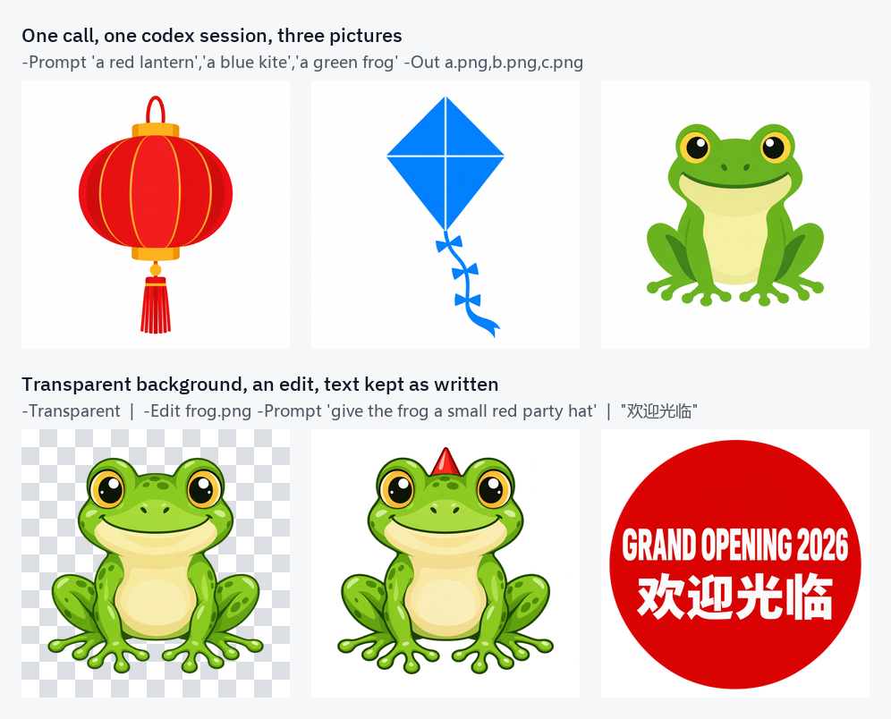

**English** | [中文](README_zh.md)

# ClaudeCode-genimg: image generation for Claude Code through the local codex CLI



*Real outputs from the test runs. Top: three prompts, one call, one codex session. Bottom: `-Transparent` (checkerboard = real alpha), `-Edit` on that frog with only the change as the prompt, and text in quotes reproduced unchanged.*

## One sentence

Ask Claude Code for a picture and it is drawn by the [codex CLI](https://github.com/openai/codex) under your **ChatGPT login, with no API key and no per-image billing**. Any number of pictures go through **one codex session**, and every run checks whether a codex update has changed the internal format the wrapper relies on, so a breakage shows up as `DRIFT` with a repair procedure instead of silently wrong files.

## Three parts

| Part | What it is |
| --- | --- |
| `skill/genimg/genimg.ps1` | A PowerShell wrapper around `codex exec`. Any number of pictures in **one** codex session, saved where you ask. |
| `skill/genimg/SKILL.md` | The Claude Code skill that tells Claude when and how to call the wrapper, when to check a picture itself, and how to repair the wrapper. |
| `mod/genimg-set/` | A Claude Code plugin adding `/genimg-set`: pick the codex model and reasoning effort from codex's own list, and self-test the wrapper. Optional. |

## What is different here

Several projects already wrap `codex exec` for pictures. This one is built around three things:

- **Few sessions, many pictures.** The image tool is rate-limited and every codex session carries a fixed overhead (about 35k tokens of context measured, most of it cached), so one call draws the whole batch in a single session, one picture after another. Runs queue behind a mutex instead of running in parallel.
- **It notices when a codex update breaks it.** The wrapper learns which file is which picture from codex's session record, an internal format that can change with any release. Every run cross-checks that record against the files codex actually left in its picture store. When they disagree the pictures are still delivered (taken from the store by time), the run prints `DRIFT …`, exits with code 2 and writes the finding to `genimg.state.json`. The skill holds the repair procedure, so Claude can then fix the script and confirm the fix with `-SelfTest`.
- **Claude's context is spent only where it matters.** codex inspects each result itself and redraws until it matches the prompt, so Claude does not look at ordinary PNGs. The exception is a picture that teaches something (a principle diagram, a flowchart, a labelled schematic): codex only checks it against the prompt, so the skill has Claude list the elements, connections and labels before drawing, check the result once against that list, and fold every fix into a single `-Edit`.

## Requirements

- Windows with Windows PowerShell 5.1.
- The codex CLI on `PATH`, logged in with a ChatGPT plan that includes image generation (`codex login`). Verified on codex `0.159.2`.
- Claude Code. The skill needs nothing more; the `genimg-set` mod is written against the function-hook plugin API of Claude Code `2.1.288` and may need changes on other versions.

## Install

```powershell
git clone https://github.com/EthanXing-xyy/ClaudeCode-genimg
Copy-Item -Recurse .\ClaudeCode-genimg\skill\genimg "$env:USERPROFILE\.claude\skills\"
```

For `/genimg-set`, load the mod folder as a plugin:

```powershell
claude --plugin-dir <path>\ClaudeCode-genimg\mod\genimg-set
# or, for every session:
setx CLAUDE_CODE_PLUGIN_DIRS "<path>\ClaudeCode-genimg\mod\genimg-set"
```

If the wrapper lives somewhere other than `%USERPROFILE%\.claude\skills\genimg`, set `GENIMG_HOME` to that folder so the mod finds it, and adjust the path in `SKILL.md`.

## Use

In Claude Code, just ask for a picture ("画一张…", "make an icon of…", "image2.5"). Or call the wrapper yourself:

```powershell
# one picture
.\genimg.ps1 -Prompt 'a red paper lantern, flat vector' -Out D:\art\lantern.png

# three pictures, one codex session
.\genimg.ps1 -Prompt 'a red lantern','a blue kite','a green frog' -Out a.png,b.png,c.png

# four takes on one prompt, transparent background: fox-1.png .. fox-4.png
.\genimg.ps1 -Prompt 'a fox mascot, sticker style' -Out fox.png -Count 4 -Transparent

# edit an existing picture; the original is never overwritten
.\genimg.ps1 -Edit frog.png -Prompt 'give the frog a small red party hat' -Out frog-hat.png

# one throwaway picture through every check
.\genimg.ps1 -SelfTest
```

Other switches: `-Ref` (reference pictures), `-Size`, `-PromptFile`, `-Tries` and `-NoCheck` (cap or turn off codex's own redraws), `-Model`, `-Effort`, `-TimeoutSec`, `-Force`.

It prints one line per picture and a closing line:

```
OK D:\art\lantern.png 1536x1024 938KB
DONE 1/1 drawn=1 37s tokens=7991 codex 5h=2% week=3% model=default effort=low
```

| Line | Meaning |
| --- | --- |
| `OK <path> <W>x<H> <n>KB [alpha\|opaque]` | a picture was saved (`alpha`/`opaque` only with `-Transparent`) |
| `MISS <path>` | that picture never came out |
| `DONE <made>/<asked> drawn=<n> … codex 5h=<n>% week=<n>%` | closing line; `drawn` counts redraws, the percentages are codex's usage meters |
| `FAIL <reason> log=<folder>` | nothing was delivered |
| `DRIFT <what did not hold> codex=<verified>-><now> log=<folder>` | pictures delivered, but codex changed; exit code 2 |

### /genimg-set

- `/genimg-set` shows the current settings and opens a list above the prompt: first codex's models (read from its `models_cache.json`, so the list follows codex updates), then the efforts of the one picked. Press a row's digit.
- `/genimg-set <model> <effort>` sets them directly; either one alone works, and `default` follows codex's own config.
- `/genimg-set test` runs the self-test. If it finds the script broken, it hands the output to Claude with a request to repair it.

Settings are kept in `genimg.json` beside the wrapper. The default effort is `low`. `ultra` is refused: it delegates to sub-agents, whose pictures the wrapper cannot follow.

## Honest limits

- Not available on this path (they need the API): masks, exact pixel size, quality level, formats other than PNG. The image model itself cannot be chosen; `-Model` picks the codex model that directs the drawing.
- Pictures are drawn one at a time. Measured on a ChatGPT Plus login: one picture about 40 s, three in one session about 106 s.
- The work folder (prompt and logs) goes under `%TEMP%\genimg`, or `GENIMG_TMP` if set. It is deleted on success and kept on FAIL or DRIFT. codex's own copies stay in `<codex home>\generated_images`.
- Windows only: the wrapper is Windows PowerShell 5.1 and the mod launches `powershell.exe`.

## Status

Tested on codex 0.159.2: single pictures, a batch of three, transparency, edits, non-ASCII text in a prompt, `-SelfTest`, settings reaching codex, and both failure paths simulated on patched copies of the script (a renamed flag gives `FAIL` without spending a picture; renamed record fields give delivered pictures plus `DRIFT`).

Not yet exercised: a run where codex actually redraws, `-Count`, `-Ref`, `-Size`, the timeout path, a `MISS`, the `/genimg-set` list in a real terminal (mounted tests only), and a real hand-over of a broken script to Claude after an actual codex update.

## Layout

```
skill/genimg/
  SKILL.md               the Claude Code skill: when to call, how to batch, when to check, how to repair
  genimg.ps1             the wrapper (ASCII only: PowerShell 5.1 reads scripts as ANSI)
mod/genimg-set/          the /genimg-set plugin
  hooks/register.tsx     the command, the model/effort pickers and the self-test hand-over
  hooks/settings.ts      parses genimg.json, the drift state and codex's model list
  tests/                 mounted tests (claude plugin test)
media/examples.png       the pictures at the top of this page
```

`genimg.json` (settings) and `genimg.state.json` (drift state) are written beside the wrapper at run time and are not committed.

## Development

```powershell
claude plugin validate .\mod\genimg-set
claude plugin test .\mod\genimg-set
```

## Contributors

- [EthanXing-xyy](https://github.com/EthanXing-xyy)
- [Claude](https://claude.com/claude-code) (Anthropic), working in Claude Code

Code under the MIT license. Pictures are generated by OpenAI's image tool through codex and count against the ChatGPT plan codex is logged in with.
